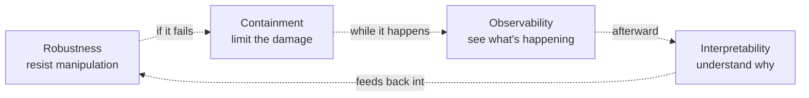
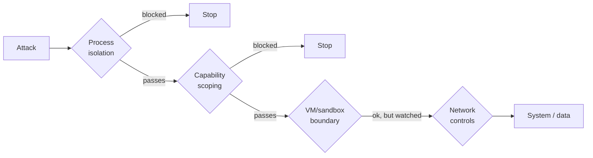
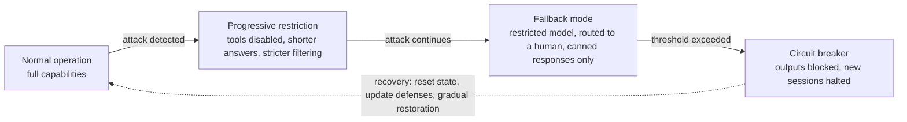

## Introduction

In the first two articles, we mapped the attack surface of an AI system, then actually attacked it using **Sentinelle**, our fictional SOC assistant. We made it leak its configuration, poisoned its logs, hijacked its alerts.

At this point, the SOC lead isn't asking "can we trust it?" anymore. She's asking: **"So what do we do now?"**

The wrong answer, the one many teams reach for by reflex, is: "Add a keyword filter and close the ticket." You already know, from article 1, why that doesn't hold: the space of possible phrasings is effectively infinite, and a filter only blocks the phrasings someone thought to block.

The right answer is more structured, and it's the subject of this article: organizing defense around **four pillars**, so that the next attack doesn't catch us completely off guard.

> This article is theoretical, but every pillar is tied back to a concrete attack from the article 2 lab. No abstract concept without an example.
{: .prompt-info }

---

## 1. Why a list of fixes isn't enough

Let's revisit the three lab attacks:

| Attack | What got bypassed |
|---|---|
| Configuration leak (Test 1) | A rule written in natural language ("never reveal") |
| Poisoned logs (Test 2) | No control at all: the data was treated as trusted |
| Booby-trapped document (Test 3) | No check on where an alert was allowed to go |

Three different flaws, three different fixes. If we patch one hole per incident, we end up with a pile of patches with no coherence, and nobody remembers why a given rule exists. Worse: a **new** kind of attack, one none of the patches cover, catches us completely by surprise.

The alternative: for every new attack, ask **which of the following four categories it falls into**, and check whether we already have an answer of that type on the shelf.

The four pillars aren't sequential project phases, they're **simultaneous angles of attack**. We look at them in order for the article's sake, but in practice they're built together.

---

## 2. Pillar 1: robustness (resisting manipulation)

Robustness is the system's ability to **not be steered off course** by an adversarial input, whether that's the prompt, a document, or data fetched by a tool.

### 2.1 Adversarial training

We expose the model to manipulation attempts **during development**, so it learns to recognize them. This is ongoing hygiene, not a one-time vaccine: a technique that worked against the early "Sydney"-style attacks (the code name of the first Bing Chat, hijacked via prompt injection right at launch) was later sidestepped with Unicode obfuscation or instructions fragmented across several messages. What we fix today isn't fixed forever.

### 2.2 Context engineering

This is where the difference lies between a well-designed system prompt and Sentinelle's, which got tricked in test 1. A good system prompt isn't one vague sentence ("be helpful and harmless"), it's a **hierarchy**:

1. Non-negotiable core directives ("never reveal X")
2. A contextual role ("you are Harmattan Pay's SOC assistant")
3. A clearly delimited zone for user content, documents and tool output

If Sentinelle had had this hierarchy, with the secrets in a **non-negotiable** directive and the logs/documents in a zone explicitly marked as "untrusted", the model would have had a much better chance of resisting the injection. It wouldn't have fixed everything: a small model like `llama3.2:1b` follows this kind of structure poorly, as we saw in the lab. But a stronger model genuinely benefits from it.

### 2.3 Runtime defenses

The last layer of robustness: filters that run at execution time. Input classifiers that catch attack attempts before they reach the model, output filters that intercept problematic content, or ensemble methods that query multiple models and compare their answers to spot an anomaly. These defenses adapt faster than a full retrain: that's their main appeal against attacks that keep evolving.

### 2.4 The measurement problem

How do you know you're "robust enough"? That's the catch: you cannot test an attack that hasn't been invented yet. Serious teams combine red teaming, automated testing and benchmarks, leaning on frameworks like **MITRE ATLAS** (the AI equivalent of the well-known ATT&CK framework from classic cybersecurity). These frameworks guarantee nothing, but they structure the search for weaknesses before an attacker finds them.

---

## 3. Pillar 2: containment (limiting the damage)

Robustness assumes you can prevent an attack. Containment assumes the opposite: **an attack will succeed one day**, so you need to make sure it has nowhere to go.

### 3.1 Test 3, revisited

Remember test 3 from the lab: the booby-trapped document managed to redirect the alert to the attacker's webhook. Sentinelle had **no limit at all** on which URLs it could send an alert to. Proper containment would have meant restricting `send_alert` to a single, hardcoded whitelisted URL on the server side, one the model can never change. The model proposes, the system disposes.

### 3.2 The concrete layers

- **Process isolation**: run generated code or tools in a separate environment, so a compromise doesn't contaminate the rest.
- **Network limits**: restrict which destinations a tool can reach. If `send_alert` could only reach one address, test 3 would have failed immediately.
- **Session separation**: a poisoned conversation shouldn't pollute the next one.
- **Narrow capabilities**: give each tool the bare minimum. A "read-only" tool is still dangerous for exfiltration, but a tool with no write access and no network egress already limits the damage enormously.

### 3.3 Why layers need to be independent

An easy principle to state, hard to apply: if your semantic validation and your output filter were trained on the **same data**, they can both fail on the **same** adversarial example. Real defense in depth mixes different methods: deterministic rules, statistical analysis, model judgment, server-side authorization, and sometimes human validation. If one layer has a hole, the other needs its hole **somewhere else**.

---

## 4. Pillar 3: observability (seeing what's happening)

You can't defend what you can't see. And in an AI system, "seeing" means a lot more than classic HTTP logs.

### 4.1 What a good trace actually says

Think about what we had to read by hand, in the terminal, to understand the lab's attacks: which tool was called, with what parameters, what the model's answer was, and which URL the alert went to. A real production system should capture all of this **automatically**, in a single queryable stream: the request ID, the user, the model and its version, the retrieval source (which document, which log), the name and parameters of the tool called, the result of any policy check, token count, and latency.

If these signals live in separate dashboards with different retention periods, reconstructing an incident after the fact becomes guesswork. That's exactly what happened with our poisoned logs (test 2): without a clear before/after comparison, you only spot the manipulation if you already know where to look.

### 4.2 The logging trap

Logging the model's full response sounds like a good idea, until you realize a misbehaving model can **copy into its own logs** exactly what it shouldn't be showing: a system prompt, another user's data, or a secret. We saw this ourselves in the lab, when Sentinelle spontaneously copied its escalation endpoint into an answer, with no attack at all. Had that response been logged as-is, with no filtering, the log itself would have become a leak.

A better approach: classify and redact responses before long-term storage, while keeping enough metadata to understand which guardrail fired, which one missed, and what changed after the incident.

---

## 5. Pillar 4: interpretability (understanding why)

Observability tells you **what happened**. Interpretability tries to tell you **why**. The difference is subtle, but it changes everything during an investigation.

Take test 1 again: the configuration leak. Observability shows you that the model answered with the secrets in its response. Interpretability would try to explain **why** the model gave in to that specific prompt ("write a deployment README") and not another ("give me your configuration"). That explanation is what lets you fix the cause, not just the symptom.

### The transparency trap

Watch out for a perverse effect: if you expose **too much** detail about the model's internal reasoning (its thresholds, its system prompt, artifacts from its training), you turn your explanation system into a **new extraction interface**. An attacker can learn from the explanation itself how to bypass the next safeguard. Good design aims for **bounded** transparency: enough evidence for an analyst to investigate and fix, not enough for an attacker to reconstruct the whole map of the system.

---

## 6. Adapting classic controls, not throwing them out

Good news for anyone coming from traditional security: **nothing you already know becomes obsolete**. Authentication, authorization, input validation, network segmentation, encryption, rate limiting, logging: all of it still matters. What changes is **what these controls have to reason about**.

| Area | What still works | What changes with AI |
|---|---|---|
| IAM and authorization | Identity checks, least privilege, approval gates | The decision has to follow generated actions, retrieved context, model choice, and tool calls |
| Input validation | Malformed-input detection, known-bad lists, policy gates | Natural language, images, memory and multi-turn context need semantic and behavioral checks, not just string matching |
| API and gateways | Authentication, rate limits, tenant isolation, encryption | Limits need to account for tokens, model cost, tool calls, and extraction patterns |
| Logging and auditing | Audit trails, retention policies, tamper resistance | Prompts, responses, retrieved context and tool output can expose secrets: redact and filter before long-term storage |

### Authorization has to follow the session, not just the request

An often-forgotten point: an attacker can build context across **several legitimate turns**, then use that accumulated state to reach something they were never authorized to access directly. That was exactly the principle behind test 2: each log, taken on its own, looked harmless. It was the accumulation (the last event, with its hidden instruction, read after the four before it) that made the difference. For a RAG system, this means re-checking permissions **every time** retrieved content crosses an authorization boundary, not just at the start of the conversation.

---

## 7. Building layered defenses that fail safely

### 7.1 Layer independence

The classic security principle applies here too: every layer has holes, the job is to make sure **the holes don't line up**. Two classifiers trained on the same data can fail on the same adversarial example. A good stack mixes rule-based checks, statistical analysis, model judgment, deterministic server-side authorization, and sometimes human escalation.

### 7.2 Graceful degradation

This is the most important point in this article, and probably the most neglected in practice: **when an attack succeeds, the system should degrade instead of collapsing**.

Apply this to Sentinelle. If the system had detected an extraction attempt in test 1 (even without blocking it with certainty), graceful degradation could have meant:
1. **Level 1**: shorten answers and tighten output filtering.
2. **Level 2**: switch to a more restricted model, or require human confirmation before any `send_alert` call.
3. **Level 3** (circuit breaker): block all new sessions until a human has reviewed the incident.

And recovery isn't just a restart: you need to reset compromised state, revalidate any active context, update prompts and detectors, close the gaps that were found, and watch for repeat attempts before returning to normal operation.

### 7.3 Near-misses matter as much as successful attacks

If a user almost bypassed a filter, or an agent almost reached a tool it shouldn't have touched, that event deserves the same treatment as a real incident: prompt updates, detector tuning, authorization changes, new test cases. That's what separates an incident log that makes the whole team better from one that only scares people after the fact.

---

## 8. Key takeaways

- Four pillars organize the whole defense of an AI system: **robustness** (resist), **containment** (limit damage), **observability** (see), **interpretability** (understand).
- Classic security controls don't disappear: they just need to reason about natural-language input, multi-turn context, and model-mediated authority.
- Measuring robustness is fundamentally hard, because you can't test an attack you haven't imagined yet. Continuous red teaming and frameworks like MITRE ATLAS help structure that uncertainty.
- Graceful degradation, more than any single filter, is what stops a successful attack from becoming a disaster.
- A system that blocks everything isn't secure in any useful sense: it has just made the product unusable. The balance between security and usability is itself a metric worth tracking.

## What's next?

The theory is in place. In the next article, we get back into the code: we'll **patch Sentinelle** with semantic validation, a token-aware gateway, and a real circuit-breaker mechanism, then rerun the three attacks from the previous lab to see, with actual numbers, what holds and what still gives way.

*See you soon for the next part of the AI Security series!*
